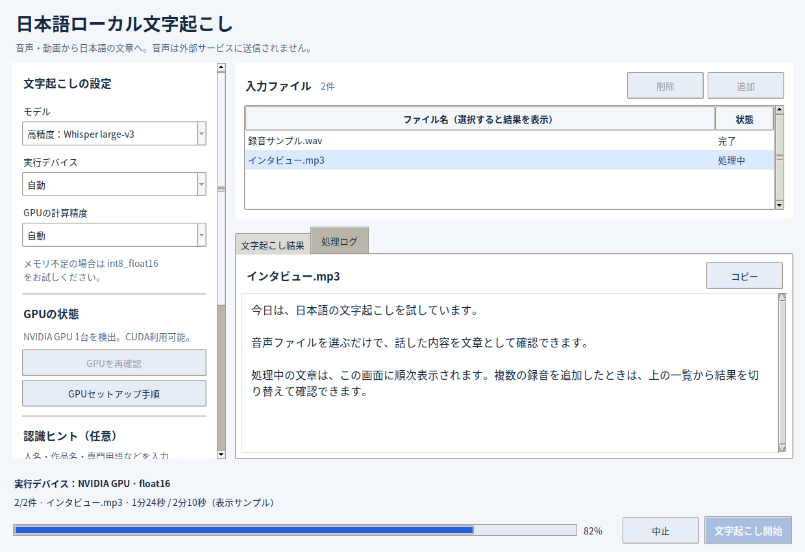

# 日本語ローカル文字起こし

Windows向けのデスクトップGUIです。音声・動画を日本語で文字起こしし、TXT・字幕ファイルなどをまとめて保存します。音声を外部APIへ送信する処理はありません。初回のモデル取得にはインターネット接続が必要です。



画面はサンプルデータによる表示例です。

## 最初の起動

1. リポジトリをZIPでダウンロードし、右クリック → **「すべて展開」** します。
2. **64bit版 Python 3.10〜3.12** をインストールします。`Add Python to PATH` を有効にしてください。
3. 展開したフォルダの **`START_HERE.bat`** をダブルクリックします。初回は必要なライブラリをセットアップします。
4. 次回からは **`run.bat`** で起動できます。

既存版から更新した場合は、新しいファイルをすべて取得したうえで **`install.bat`** をもう一度実行してください。既存の `models` フォルダは引き続き利用できます。

## NVIDIA GPUで文字起こしする

1. NVIDIA GPUのドライバーを更新します。
2. アプリを閉じて **`install_gpu.bat`** をダブルクリックします。
3. セットアップ完了後、**`run.bat`** で起動します。
4. 左側の「GPUの状態」を確認し、実行デバイスで **「NVIDIA GPU」** を選びます。
5. ファイルを追加して「文字起こし開始」を押します。画面下部に **実際に使っているデバイスと計算精度** が表示されます。

`install_gpu.bat` は公式NVIDIAのCUDA 12 / cuDNN 9関連ランタイムを、このアプリの `.venv` にインストールします。大きなダウンロードと数GBの空き容量が必要になる場合があります。CUDA Toolkitをシステム全体に導入する必要はありませんが、対応するNVIDIAドライバーは別途必要です。AMD・Intel GPUやApple GPUには対応していません。

| 実行デバイス | 動作 |
| --- | --- |
| 自動 | GPUを優先。利用できない場合やCUDA関連エラー時は、理由を画面に表示してCPUで実行・再試行 |
| NVIDIA GPU | GPUで実行。利用できない場合はエラーを表示し停止。CPUへの自動切り替えはしない |
| CPU | CPUの `int8` で実行。GPUの確認は不要 |

GPU計算精度の「自動」は対応する `float16` → `int8_float16` → `float32` の順で選択します。GPUメモリが不足するときは **`int8_float16`**、または軽いモデルを試してください。認識速度はGPU・モデル・音声によって変わります。

### GPUが利用できないとき

- 「GPUセットアップ手順」ボタンから手順を確認できます。
- `cublas64_12.dll` / `cudnn_ops64_9.dll` などの不足が表示されたら、アプリを閉じて `install_gpu.bat` を実行し、最後に `GPU setup complete` と表示されることを確認してから `run.bat` で起動してください。DLLの一部が欠けている場合、`install_gpu.bat` はNVIDIAランタイムを自動で再インストールします。
- 「処理ログ」のGPU診断には、使用中のPython、見つかったDLLフォルダー、DLLごとの原因（見つからない／読み込み失敗）が表示されます。
- 「仮想メモリ（ページングファイル）不足」と表示された場合は、Windowsの仮想メモリを増やすか、他のアプリを閉じてから再起動してください。
- DLLは仮想環境内の `nvidia/*/bin` から自動登録します。手動配置する場合はアプリの `cuda/bin`、またはWindowsのPATH上に配置できます。
- 「GPUを再確認」で診断を更新できます。診断は事前確認で、モデルの読み込み・推論が成功することまでは保証しません。
- ドライバーの不整合やGPUメモリ不足の詳細は「処理ログ」で確認できます。
- WindowsでPythonライブラリ自体を読み込めない場合は、Microsoft Visual C++再頒布可能パッケージ（x64）も確認してください。

## GUIの使い方

- **左側：設定** — モデル、デバイス、GPU精度、認識ヒント、保存先。縦にスクロールできます。
- **右上：入力ファイル** — 「追加」で複数の音声・動画を登録し、「削除」で選択したファイルを外します。
- **右側：結果** — 処理中から文章を順次表示します。ファイル一覧を選択すると、そのファイルの結果へ切り替わります。「コピー」で文章をコピーできます。
- **処理ログ** — モデル準備、CPUへ切り替わった理由、保存先、エラーの詳細を確認できます。
- **画面下部** — 実際のデバイス、進捗、状態、「文字起こし開始」「中止」をまとめています。

処理中は入力・設定を固定し、誤操作を防ぎます。モデル準備中は進捗バーが動き、解析が進むと割合を表示します。割合は処理済みの音声時間とファイル数に基づく目安です。

「中止」は次の処理の区切りで反映されます。モデルのダウンロード・読み込みや音声解析中は、停止まで時間がかかる場合があります。完了済みのファイルは保存したまま、処理途中のファイルの結果は保存しません。

同じ出力名になる入力の組み合わせは、上書きを避けるため受け付けません。保存先に以前の結果がある場合は、開始前に上書きを確認します。

## モデル

| モデル | 用途 |
| --- | --- |
| Whisper large-v3 | 精度優先の初期設定。CPUでは時間がかかる場合があります |
| Kotoba Whisper v2.0 | 日本語向け。音声に応じて比較してください |
| Whisper large-v3-turbo | 速度を重視する場合 |
| Whisper medium | より軽いモデルが必要な場合 |

初回のみモデルを `models` にダウンロードし、次回からキャッシュを再利用します。認識ヒントには人名・作品名・専門用語などを入力してください。例文は自動入力されないため、ヒントを使わない場合は空欄のままで構いません。

## 対応形式と保存されるファイル

MP3 / WAV / M4A / FLAC / OGG / AAC / WMA / OPUS / MP4 / MOV / MKV / WEBM。システムへのFFmpegのインストールは不要です。

| ファイル | 内容 |
| --- | --- |
| `音声名.txt` | 本文（BOM付きUTF-8） |
| `音声名_timestamps.txt` | 時刻付き本文（BOM付きUTF-8） |
| `音声名.srt` | 字幕（BOM付きUTF-8） |
| `音声名.vtt` | WebVTT字幕 |
| `音声名.json` | セグメント、モデル、実際のデバイス・精度など |

## 開発・検証

GUIはPython標準のTkinterを使用します。モデル推論はGUIとは別スレッドで処理し、キュー経由で画面を更新します。

```console
python -m pip install -r requirements.txt
python -m unittest discover -s tests -v
python app.py
```

テストはモデルをダウンロードせず、GPU選択、DLLの探索、GPU失敗時の再試行、明示GPU指定、キャンセル、出力形式などを検証します。GUIスモークテストはデスクトップ環境、またはLinuxのXvfb上で実行できます。

```console
python -m unittest discover -s tests -p 'gui_smoke.py' -v
```

GPUに関する参照：
- [faster-whisper GPU requirements](https://github.com/SYSTRAN/faster-whisper#gpu)
- [NVIDIA cuBLAS runtime](https://pypi.org/project/nvidia-cublas-cu12/)
- [NVIDIA cuDNN runtime](https://pypi.org/project/nvidia-cudnn-cu12/)
